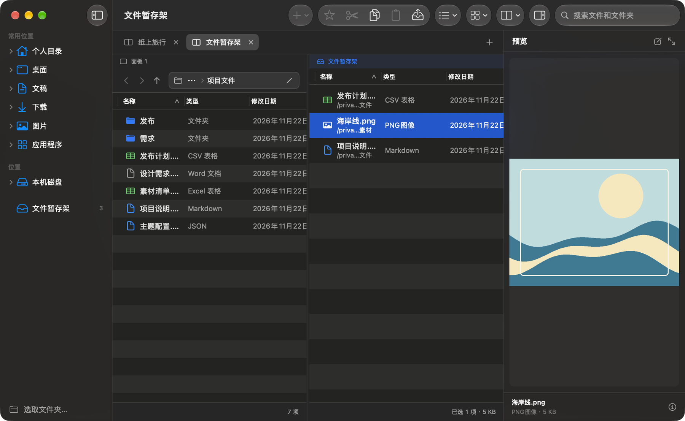

# wfolder

wfolder 是一款用 SwiftUI 和 AppKit 开发的原生 macOS 文件管理器。可在同一窗口分割多个文件面板，跨目录拖放文件，并把常用布局保存为命名工作区。


## 功能

- **多面板与标签页**。左右或上下分割任意面板，拖动分隔线调整大小。各面板独立保存目录、历史、搜索和选择，预览跟随当前面板。
- **命名工作区与会话恢复**。保存当前标签页的布局，随时在新标签页打开。重新启动时恢复上次的标签页、各面板目录、分割比例、视图和当前面板。
- **文件暂存架**。从侧栏打开独立面板，把散落在不同目录的文件拖入后集中处理。选中即可预览，用默认应用打开可修改原文件。拖到其他目录面板时默认复制，按住 `⌘` 可移动。
- **列表、缩略图与搜索**。切换详情列表和缩略图网格，按类型或修改日期分组，调整显示列和列宽。按文件名搜索当前目录或各级子目录，结果显示所在路径。Spotlight 可搜索文件内容和 Finder 标签。
- **多格式预览**。支持图片、PDF、音视频、CSV、TSV、Markdown 和代码等。大文本和 CSV、TSV 按滚动位置加载。Office、iWork 和其他格式可使用 macOS 提供的快速查看预览。
- **批量操作**。右键可复制、移动、压缩或批量重命名。重命名前可预览名称和冲突。选择两个目录面板可对比内容、复制差异或单向同步。ZIP 可直接浏览并按项解压。
- **按格式新建文件**。工具栏「＋」提供 TXT、Markdown、RTF、PDF、DOCX、XLSX、CSV、TSV、PPTX、JSON、YAML、HTML、XML 和 SVG 模板。



## 传输队列与撤销

通过工具栏「文件操作」查看跨面板传输与粘贴任务。队列显示来源、目标、已完成数量和失败原因。可以取消运行中或排队的任务，或只重试失败的项目。

同名项目会集中显示来源、大小和修改时间。可逐项设置，或把同一个选择应用到整批。普通文件可替换，原有目标文件会移入废纸篓。文件夹可跳过或保留两份。

「操作历史」保留近期记录。可撤销最近一次移动、重命名、批量重命名或移到废纸篓。撤销前会检查文件和原路径，遇到占用或已变更的文件时会显示原因。

## 从源码构建

使用带 macOS 27 SDK 的 Xcode 或 Command Line Tools。macOS 27 提供截图所示的原生界面。

```sh
git clone https://github.com/fantasticit/wfolder.git
cd wfolder
./Scripts/build-app.sh
open dist/wfolder.app
```

脚本按当前 Mac 的 CPU 架构构建并本地签名，Office 模板会随应用打包。macOS 首次访问桌面、文稿或下载文件夹时可能请求相应权限。

## 常用操作

| 快捷键 | 操作 |
| --- | --- |
| `⌘D` / `⇧⌘D` | 左右分割 / 上下分割 |
| `⌘W` | 关闭当前面板。标签页仅剩一个面板时关闭该标签页，最后一个标签页会保留 |
| `⌘T` / `⌃Tab` | 新建标签页 / 切换到下一个标签页 |
| `⌘S` | 打开命名工作区管理器 |
| `⌘L` / `⇧⌘G` | 编辑地址。输入文件路径可定位并预览文件 |
| `⌘F` / `⌥⌘F` | 搜索文件名 / Spotlight 搜索内容或标签 |
| `空格` / `⌥⌘P` | 放大预览 / 切换预览面板 |
| `⌘N` / `⇧⌘N` | 新建文件 / 文件夹 |
| `⌘O` / `Return` | 打开 / 重命名所选项目 |
| `⌥⌘Z` | 撤销最近一次可撤销的文件操作 |
| `⌥⌘C` / `⌥⌘X` | 复制 / 移动到其他面板 |

在目录面板之间拖动时，同卷默认移动，跨卷默认复制，按住 `⌥` 可复制。拖到面板空白处使用面板当前目录，拖到文件夹上使用该文件夹。同名时可在传输队列处理。
