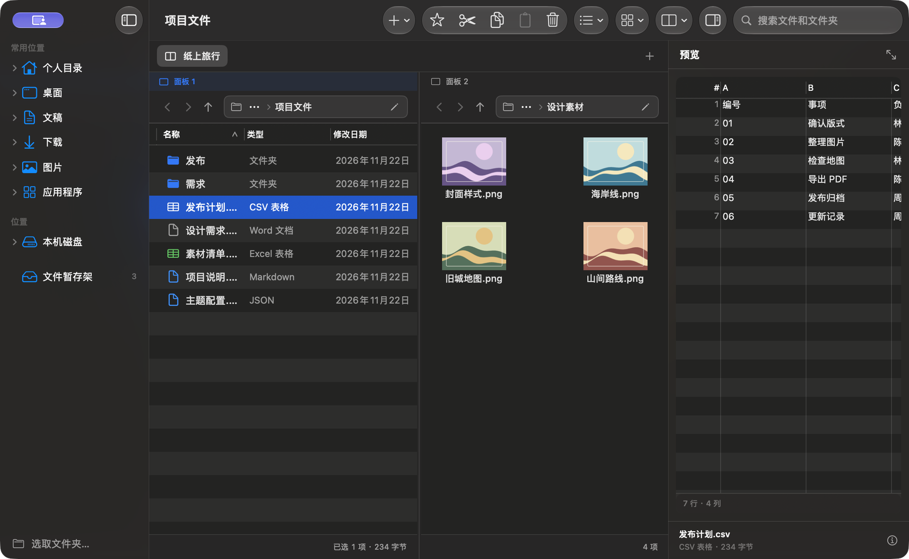

# wfolder

wfolder 是一款用 SwiftUI 和 AppKit 开发的原生 macOS 文件管理器。可在同一窗口分割多个文件面板，跨目录拖放文件，并把常用布局保存为命名工作区。



## 功能

- **多面板与标签页**。左右或上下分割任意面板，拖动分隔线调整大小。各面板独立保存目录、历史、搜索和选择，预览跟随当前面板。
- **经常访问**。侧栏根据在 wfolder 中打开文件的频率和时间自动更新，记录保存在本机。右键可定位文件或移出列表。
- **快速访问首页**。新标签页可查看已固定的文件与文件夹、最近打开的文件和命名工作区。可拖动或右键调整固定项顺序。「设置 → 通用」可选择启动时恢复会话及新标签页的默认页面。
- **命名工作区与会话恢复**。保存当前标签页的布局，随时在新标签页打开。重新启动时恢复上次的标签页、各面板目录、分割比例、视图和当前面板。
- **文件暂存架**。从侧栏打开独立面板，把散落在不同目录的文件拖入后集中处理。选中即可预览，用默认应用打开可修改原文件。拖到其他目录面板时默认复制，按住 `⌘` 可移动。
- **列表、缩略图与搜索**。切换详情列表和缩略图网格，按类型或修改日期分组，调整显示列和列宽。按文件名搜索当前目录或各级子目录，结果显示所在路径。Spotlight 可搜索文件内容和 Finder 标签。
- **按目录保存视图和复选框多选**。重新进入目录时恢复布局、排序、分组、列顺序和列宽。在「视图」启用项目复选框，使用全选或反选。状态栏显示所选文件的数量和总大小。
- **工作区搜索**。在搜索区切换仅当前目录、包含子目录或当前工作区，按文件类型和修改日期筛选。当前工作区覆盖活跃标签页里的目录面板。
- **多格式预览**。支持图片、音视频、PDF、DOCX、OTF、TTF、XLSX、CSV、TSV 和代码。PDF 可连续滚动，DOCX 保留可导入的段落样式和表格，字体文件可显示多种字号的样张。XLSX 可切换工作表，并按滚动位置加载单元格。SQL、TypeScript、JavaScript、Swift、Python 等源码支持语法高亮。大文本和 CSV、TSV 按滚动位置加载。其他 Office、iWork 文件可使用 macOS 快速查看。
- **Markdown 预览**。可切换渲染与源码，支持本地和网络图片、标题、表格、代码块语法高亮和 Mermaid 图表。图表在滚动到附近时离线绘制，超过 2 MiB 的 Markdown 文件可按页浏览完整源码。
- **隔空投送**。右键选中的文件或文件夹，或在「文件」菜单中选择「隔空投送…」，通过 macOS 选择接收设备。支持多选。
- **在 Visual Studio Code 中打开**。在详情列表、缩略图网格或暂存架中右键文件或文件夹，即可交给已安装的 Visual Studio Code。支持多选。
- **批量操作**。右键可复制、移动、压缩或批量重命名。重命名前可预览名称和冲突。选择两个目录面板可对比内容、复制差异或单向同步。ZIP 可直接浏览并按项解压。
- **任意目录传输与右键打开方式**。在「复制到…」或「移动到…」中，从收藏、最近目标、当前面板或手输路径选择目标。右键「打开方式」可用系统默认应用、VS Code 或单个文件的其他兼容应用。
- **高级搜索与智能文件夹**。组合文件名、Spotlight 内容、Finder 标签、扩展名、大小与修改日期。结果可在独立面板预览、多选和拖拽，常用条件可保存到侧栏。
- **命令面板与路径补全**。在地址栏和「前往路径」中按 Tab 补全建议。命令面板可搜索操作、工作区和智能文件夹。可在「显示」菜单启用 Windows 键位，使用 F2 重命名、F5 刷新和 Option 加方向键导航。
- **归档面板**。ZIP、TAR、7z 和 RAR 可与目录并排打开。选择归档成员即可预览，拖到普通目录面板可按项解压。
- **目录联动与同步计划**。将常用目录对保存到工作区，按相对路径联动导航，比较同名文件的预览，核对新增、更新、冲突和保留项。
- **服务器与云端状态**。保存 SMB/NAS、WebDAV 和 SFTP 位置，挂载后在独立面板浏览和传输。SFTP 挂载使用本机的 macFUSE、SSHFS、SSH 密钥和已信任的服务器。iCloud 文件可显示下载或同步状态。
- **整理规则**。保存筛选、重命名和移动条件，执行前查看目标名称和冲突。已完成的移动可从操作历史撤销。
- **按格式新建文件**。工具栏「＋」提供 TXT、Markdown、RTF、PDF、DOCX、XLSX、CSV、TSV、PPTX、JSON、YAML、HTML、XML 和 SVG 模板。


## AI 助手

按 `⌥⌘A` 打开 AI 助手，选择「配置服务」，填写 OpenAI、DeepSeek 或兼容服务的模型和 API Key，再测试连接并保存。自定义服务需要兼容 Chat Completions 接口。

点击助手标题栏的图钉，可以固定到窗口右侧，在浏览文件时继续聊天。右侧同时启用文件预览时，可拖动分隔线调整上下空间。点击「在弹窗中打开」可切回弹窗，隐藏后也可用 `⌥⌘A` 重新显示。wfolder 会记住上次的展示方式。

在底部输入「找下载里最近 7 天修改的 PDF」，按 `↩` 发送，按 `⇧↩` 换行。可以接着说「改成最近 30 天」来调整条件。移动文件等操作会显示待确认卡片。

也可以说「搜一下 AIGC 的架构文档」。助手用模型拆解项目和主题，在本机按中英文同义词匹配文件名、目录和可检索的内容。聊天显示实际搜索目录、匹配数量和部分文件，可继续问「刚才搜到了什么」，也可直接「换目录重搜」。文件名与内容留在本机，近期对话只会附带搜索结果的计数。

通过助手右上角的「自动整理权限」授权文件夹后，可以说「帮我整理下载目录」。助手默认将该目录中的文件按类型分入子文件夹，跳过同名文件。需要整理子目录时可在指令里指定。聊天中会显示移动和跳过的结果，移动可从操作历史撤销。可随时在「AI 权限」查看或撤销授权。

支持流式输出的模型会边生成边显示文字。文件操作会显示为操作卡片，自动整理开始后会显示进度状态和结果。

对话保存在本机，重启后会恢复上次打开的对话。点助手右上角的「对话历史」可切换会话，右键可删除会话。「新对话」会单独建立一个会话。历史中尚未执行的操作可重新编辑并发送。

API Key 保存在 macOS 钥匙串。应用读取成功后，会在本次运行中从内存复用。模型服务接收当前消息、同一服务的近期对话和操作说明。文件内容、选区和搜索结果在本机处理。

## 传输队列与撤销

通过工具栏「文件操作」查看跨面板传输与粘贴任务。队列显示来源、目标、已完成数量和失败原因。可以取消运行中或排队的任务，或只重试失败的项目。

同名项目会集中显示来源、大小和修改时间。可逐项设置，或把同一个选择应用到整批。普通文件可替换，原有目标文件会移入废纸篓。文件夹可跳过或保留两份。

「操作历史」保留近期记录。可撤销最近一次移动、重命名、批量重命名或移到废纸篓。撤销前会检查文件和原路径，遇到占用或已变更的文件时会显示原因。

## 从源码构建

使用带 macOS 27 SDK 的 Xcode 或 Command Line Tools。macOS 27 提供截图所示的原生界面。

```sh
git clone https://github.com/fantasticit/wfolder.git
cd wfolder
./Scripts/build-app.sh
open dist/wfolder.app
```

脚本按当前 Mac 的 CPU 架构构建并本地签名，Office 模板和 Markdown 渲染资源会随应用打包。macOS 首次访问桌面、文稿或下载文件夹时可能请求相应权限。

修改 Markdown 渲染器后，可用 Node.js 22.12 或更高版本更新打包资源。

```sh
npm --prefix Scripts/Markdown ci
npm --prefix Scripts/Markdown run build
```

## 从 Finder 打开

将 wfolder 放入「应用程序」并打开一次。在 Finder 中右键所选文件或文件夹，选择「在 wfolder 中打开」。入口也可能位于「服务」子菜单中。文件夹在新标签页打开，文件在所在目录中定位。多选同一目录中的文件时，会在一个标签页中选中它们。

按 `⌘,` 前往「设置」→「默认打开」。文件夹可以单独设置。PDF、Markdown、CSV、XLSX 等格式可勾选多项，或点「全选」将列表中的格式统一设置为 wfolder。macOS 要求确认时会依次显示提示。设置完成后可在列表里查看各项状态，并恢复已有记录的原应用。Finder 的桌面、Dock 和部分定位入口由 macOS 管理。

## 常用操作

| 快捷键 | 操作 |
| --- | --- |
| `⌘D` / `⇧⌘D` | 左右分割 / 上下分割 |
| `⌘W` | 关闭当前面板。标签页仅剩一个面板时关闭该标签页，最后一个标签页会保留 |
| `⌘T` / `⌃Tab` | 新建标签页 / 切换到下一个标签页 |
| `⌘S` | 打开命名工作区管理器 |
| `⌘L` | 编辑当前面板的地址栏，Tab 补全路径 |
| `⇧⌘G` | 打开「前往路径」弹窗。回车进入目录，文件路径会定位并预览文件 |
| `⌘F` / `⌥⌘F` | 搜索文件名 / Spotlight 搜索内容或标签 |
| `⇧⌘F` / `⇧⌘P` | 高级搜索 / 命令面板 |
| `⌥⌘A` | AI 助手 |
| `⌃⌥←↑↓→` | 切换到对应方向的面板 |
| `空格` / `⌥⌘P` | 放大预览 / 切换预览面板 |
| `⌘N` / `⇧⌘N` | 新建文件 / 文件夹 |
| `⌘O` / `Return` | 打开 / 重命名所选项目 |
| `⌥⌘Z` | 撤销最近一次可撤销的文件操作 |
| `⌥⌘C` / `⌥⌘X` | 复制 / 移动到其他面板 |

在目录面板之间拖动时，同卷默认移动，跨卷默认复制，按住 `⌥` 可复制。拖到面板空白处使用面板当前目录，拖到文件夹上使用该文件夹。同名时可在传输队列处理。
